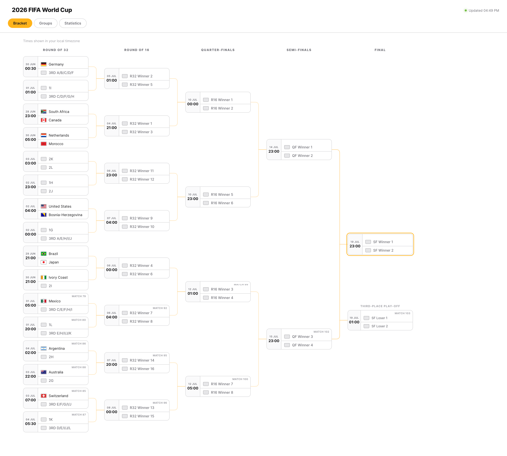
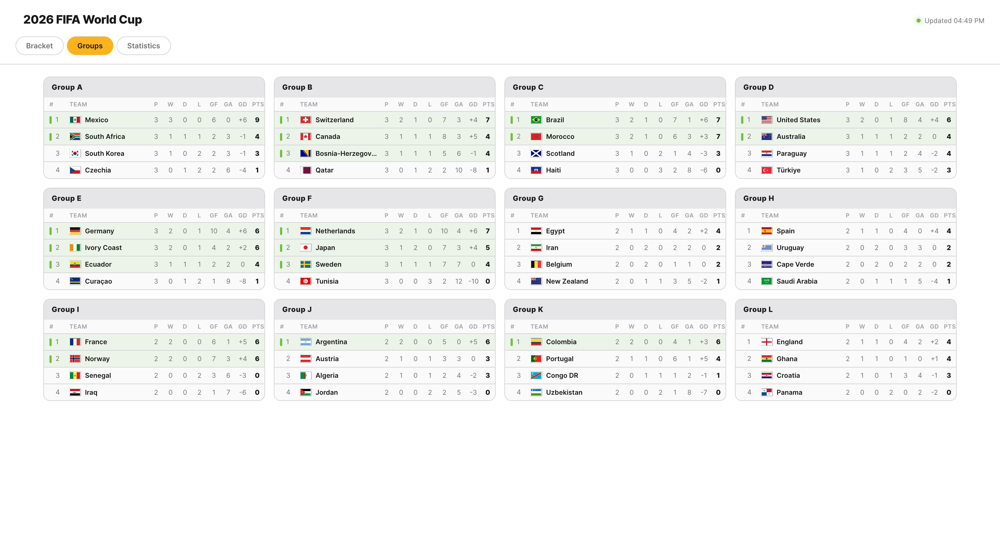
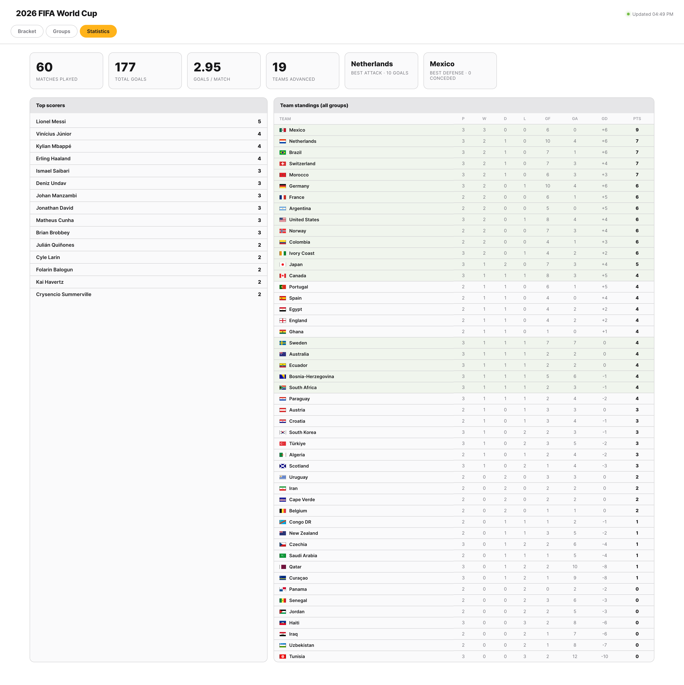

# FIFA World Cup 2026 — Live Bracket & Statistics

An interactive knockout-bracket tracker for the 2026 FIFA World Cup, plus group tables and
tournament statistics. A Python backend polls live data every 3 minutes and writes self-describing
JSON to `results_data/`; a Svelte (Vite) frontend renders a FIFA-2026-styled UI.





## Architecture

```
backend/   FastAPI + background poller  → ESPN's undocumented public API → normalized model → results_data/*.json
frontend/  Svelte (Vite, not SvelteKit) → polls backend  → Bracket / Groups / Statistics tabs
results_data/  Stack-agnostic JSON snapshots (rewritten every poll cycle)
```

### Data source
ESPN's public, key-less soccer endpoints for the `fifa.world` league (season 2026):
- **Fixtures + knockout** — `site.api.espn.com/.../fifa.world/scoreboard?dates=20260611-20260719`
- **Group standings** — `site.api.espn.com/.../fifa.world/standings`
- **Official match numbers** — `sports.core.api.espn.com/v2/.../events/{id}` exposes
  `competitions[0].matchNumber` ("Match 74"); the scoreboard omits it. These are immutable, so the
  backend fetches each knockout event's number once and caches it. The within-round sequence used in
  feeder labels (`"Round of 32 2 Winner"`) is the rank by `matchNumber`, so rounds are ordered by it.

No API key, no rate limit. The backend derives the full bracket tree (which match feeds which)
purely from ESPN's data — within each round, events are numbered by ascending event id, and later
rounds reference their feeders by that number (e.g. `"Round of 32 3 Winner"`). No FIFA topology is
hardcoded, so the bracket fills in automatically as the group stage resolves.

## Running

### Backend (Python ≥ 3.10)
```bash
cd backend
python3 -m venv .venv
.venv/bin/pip install -r requirements.txt
.venv/bin/uvicorn app.main:app --port 8000 --reload
```
On startup it fetches once, then re-polls every 3 minutes (`POLL_INTERVAL_SECONDS` in
`app/config.py`). Each cycle rewrites `results_data/`.

Endpoints: `/api/tournament`, `/api/bracket`, `/api/groups`, `/api/statistics`, `/api/health`,
and the raw files under `/results_data/`.

### Frontend (Node ≥ 18)
```bash
cd frontend
npm install
npm run dev        # http://localhost:5173
```
The frontend reads `http://localhost:8000` by default; override with `VITE_API_BASE`. Tabs are
deep-linkable via hash (`#bracket`, `#groups`, `#statistics`). Times render in the viewer's local
timezone. Each match card calls an `onselect` hook (currently a stub) for future interactivity.

## `results_data/` — stack-agnostic snapshot

`tournament.json` is self-describing: any renderer can rebuild this exact UI without calling ESPN.
Per-section files (`bracket.json`, `groups.json`, `statistics.json`) are also written.

```jsonc
{
  "generated_at": "2026-06-26T...Z",
  "source": "espn fifa.world 2026",
  "schema_version": 1,
  "competition": { "name": "2026 FIFA World Cup", "season": 2026 },

  "bracket": {
    "rounds": [
      {
        "key": "round-of-32", "label": "Round of 32", "short": "R32",
        "matches": [
          {
            "id": "r32-1",
            "match_number": 1,             // within-round sequence (used by "Round of 32 1 Winner")
            "official_match_number": 73,   // FIFA tournament-wide match number ("Match 73")
            "event_id": "760486",
            "kickoff_utc": "2026-06-28T19:00:00Z",
            "status": "scheduled|live|final",
            "venue": { "name": "...", "city": "...", "country": "..." },
            "home": {
              "name": "South Africa",   // resolved team or ESPN placeholder text
              "display": "South Africa", // label to show (combined "A/B" for R16, "Winner R16 1" for QF+)
              "short": "RSA",            // group code (1F/2F/3ABCDF) for unresolved group slots
              "team_id": "...", "abbreviation": "RSA",
              "flag_url": "https://a.espncdn.com/...png",  // null for placeholders
              "score": null,            // int when status is live/final
              "winner": false,
              "is_placeholder": false,
              "feeder_match_id": "..."  // present when this slot is "winner of match X"
            },
            "away": { ... },
            "feeds_into": [             // where this match's result flows next
              { "match_id": "r16-1", "slot": "home", "takes": "winner" }
            ]
          }
        ]
      }
      // round-of-16, quarterfinals, semifinals, final, third-place
    ]
  },

  "groups": [
    { "name": "Group A", "standings": [
      { "rank": 1, "team": "Mexico", "abbreviation": "MEX", "flag_url": "...",
        "played": 3, "won": 3, "drawn": 0, "lost": 0,
        "gf": 6, "ga": 0, "gd": 6, "points": 9, "record": "3-0-0", "advanced": true }
    ]}
  ],

  "statistics": {
    "tournament_totals": { "matches_played": 54, "total_goals": 161, "avg_goals_per_match": 2.98,
                           "teams_advanced": 13, "best_attack": {...}, "best_defense": {...} },
    "team_aggregates": [ { "team": "...", "points": 9, "gf": 6, ... } ],
    "top_scorers": [ { "player": "...", "team": "ARG", "goals": 5 } ]
  }
}
```

### Rendering the bracket elsewhere
Order each round so feeders are adjacent (post-order DFS over `feeds_into` winner-links starting
from the `final`), lay rounds out left→right in columns, and draw a connector from each match to the
match named in its `feeds_into`. `display` already mirrors the reference layout; `feeds_into` gives
the edges. See `frontend/src/components/BracketView.svelte` for a reference implementation.

## Notes
- Not affiliated with ESPN. Use responsibly and follow ESPN's terms of service.
- ESPN endpoints are unofficial; the backend parses defensively and keeps the last-good snapshot if
  a fetch fails.
- `top_scorers` is aggregated best-effort from per-match scoring plays; it grows as matches are
  played.
